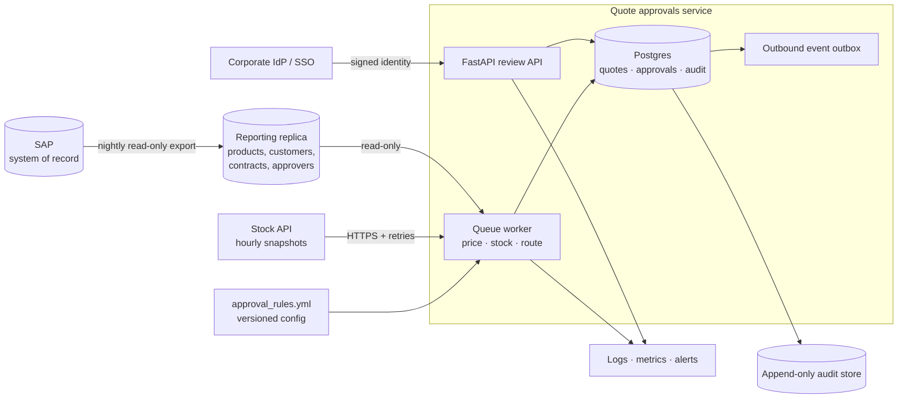

# Ridgeline Quote Approvals

Service that turns extracted draft quotes into priced, stock-checked, routed
approval requests. Every quote still gets a human sign-off before it can reach
a customer.

## Repository

https://github.com/alexolmedo/data-pack_platform

## How to Run

Requires Python 3.9+.

```bash
python3 -m venv .venv
source .venv/bin/activate
pip install -r requirements.txt
```

Start the local stock API and process the sample drafts:

```bash
  # Terminal 1 - deterministic stock snapshots for the demo
  MOCK_FAILURE_RATE=0 python mock_stock_api.py

  # Terminal 2 - writes outputs/routing_results.json
  python -m app.pipeline
```

`python -m app.pipeline --fixture` runs the same pipeline offline against
`stock_fixture.json`. `--reset` clears the local SQLite database and
`--output PATH` writes the results elsewhere.

Start the review API:

```bash
uvicorn app.api:create_app --factory --port 8000
```

Users are identified by the `X-User-Id` header and resolved against
`reporting_db/approvers.csv`:

```bash
curl -H 'X-User-Id: S01' http://localhost:8000/quotes/queue
curl -H 'X-User-Id: S01' http://localhost:8000/quotes/DQ-24101
curl -X POST -H 'X-User-Id: S01' \
  -H 'Content-Type: application/json' \
  -d '{"note":"looks good"}' \
  http://localhost:8000/quotes/DQ-24101/approve
```

Run the tests:

```bash
pytest -q
```

Approval rules live in `config/approval_rules.yml`. Environment variables
(also listed in `.env.example`) are `STOCK_API_URL`, `REPORTING_DB_PATH`,
`APP_DB_PATH`, `ROUTING_OUTPUT_PATH`, `RIDGELINE_CONFIG` and `POLICY_NOW`.
The sample clock is already pinned in the YAML; set `POLICY_NOW` to override it.

## Approach

**Pricing.** Drafts come from `draft_quotes.json`; products, customers and
contracts come from the read-only nightly export in `reporting_db/`. Each line
uses the customer's contract price when one is valid on the policy date
(`valid_from <= today <= valid_to`), otherwise the list price. An expired
contract falls back to list and raises a line-level specialist flag. All money
math uses `Decimal` and rounds half-up to cents. `net_total` applies the
draft's `proposed_discount_pct`; `effective_discount_pct` is measured against
the full list-price total, as the policy requires.

**Stock.** Unique part numbers are fetched through the batch endpoint. Each
part ends up `ok`, `not_found`, `out_of_stock`, or `unavailable`; readings
older than 24 hours are marked stale. Missing and out-of-stock parts become
line-level specialist flags. An API outage after retries becomes one
quote-level flag, so the quote is visible and reviewable rather than blocked
or guessed.

**Routing.** `config/approval_rules.yml` holds the thresholds, role names,
data-quality limits, retry policy and specialist assignment strategy. Effective
discount over 25% goes to the VP; over 15%, or a net total of at least
$25,000, goes to the customer's regional manager; everything else is
specialist-only. Approver out-of-office dates and backup chains come from
`approvers.csv`; backups are followed with a cycle guard. The specialist is
the draft's `prepared_by` when active, otherwise their backup or the first
available specialist. Any extraction confidence below 0.85 is flagged for
specialist review.

**Review and audit.** Quotes, lines, approval requests and audit events live in
SQLite (`APP_DB_PATH`). A specialist signs off every quote; a manager or VP can
only approve after that sign-off. Every action writes who, what, when, status
before/after, and JSON before/after values in the same transaction. A unique
approval request per draft plus a guarded status update prevents a second
approval from taking effect.

**Duplicates.** A draft is a duplicate when it has the same `rfq_id` and the
same normalized lines as another draft received in the last 24 hours. It gets
`duplicate_of` and no approval request.

**What is stubbed.** `PUT /quotes/{id}` records an `edit_requested` audit event
and returns 501 with the before/after values. Production would apply the
change, reprice it with `price_quote`, re-run the stock check, reroute with
`route_quote`, cancel the previous approval request, and notify the new
approver. Authentication is a header for this exercise; production uses the
corporate IdP. There is no UI and no write path to SAP.

**The one decision that matters most.** Route on effective discount against
list price, not the proposed discount. Contract prices can sit below list, so a
draft asking for 22% can actually be a 26.22% discount and belongs with the VP
(DQ-24103). Measuring the real discount prevents under-routing and margin
leakage.

## Reliability

**Stock retries.** Calls use a 2s timeout and four attempts with exponential
backoff and jitter, honoring `retry_after_seconds` or `Retry-After` from the
API. Only 429/5xx responses and transport/timeout errors are retried. When retries are exhausted the part is
`unavailable`, never blocked or guessed, and the quote carries
`stock unavailable after retries`.

**Stale or unavailable data.** Stock readings older than 24 hours are flagged
per line. A reporting export older than 36 hours, or one with no timestamp,
adds a quote-level "data must be confirmed" flag. A pricing failure raises a
clear draft-specific error instead of silently pricing a line at zero.

**Duplicates and double decisions.** Duplicate detection uses
`rfq_id` + a SHA-256 of normalized, order-independent lines inside the 24-hour
window. Duplicates create no approval request. One request per draft (unique
constraint) and `UPDATE ... WHERE status = ?` guards mean a repeated or
concurrent approval cannot apply twice.

**Roles.** Only a user with the specialist role or the routed approver can
approve or reject. Specialists sign off first; managers and VPs approve after
that. Production replaces `X-User-Id` with SSO/OIDC, signed tokens, and
server-side authorization with an approval audit trail.

**Tests.** `pytest -q` runs 90 tests covering every approval tier and boundary,
the OOO backup chain (including a backup falling through to the VP), duplicate
detection and the duplicate window, specialist/approver ordering, RBAC,
double-approval conflicts, stock retries and exhausted retries, stale stock,
stale reporting data, the API surface, the edit stub, and the committed
`outputs/routing_results.json` contract. Re-running the pipeline is safe: it
rebuilds the output without duplicating audit entries or approval requests.

## Production



**Deployment.** The service runs as a containerized FastAPI app behind the
company API gateway, with a separate worker for batch pricing/routing and a
scheduled job for incoming drafts. Postgres replaces local SQLite. Secrets come
from the secrets manager. Reporting access uses a read-only replica credential.
There is no SAP SDK or write credential in the service; approved quotes are
emitted to an outbox/event queue for Ridgeline IT to post in SAP.

**Monitoring.** Track draft-to-specialist time, draft-to-final-approval p50/p95,
the percentage over four hours (the original problem), queue depth by approver,
approval/rejection counts, conflict rates, stock retry exhaustion, stale stock
and reporting rates, duplicate rate, and audit write failures. Alert on a
rising approval backlog, a stock retry-exhaustion spike, or reporting data older
than 36 hours.

**Changing rules without a code release.** `approval_rules.yml` is versioned
and validated at startup. In production, rules live in a config service or
database with an admin UI, validation, a maker/checker approval step, an audit
trail, and canary/rollback. Thresholds, role names, data-quality limits and
retry policy update without deploying code; approver availability and regions
continue to come from the reporting/HR source.

**With two more weeks.** Add SSO/OIDC and fine-grained RBAC, move to
Postgres + a durable queue with idempotency keys, build the SAP outbox
integration with Ridgeline IT, add a reviewer UI, add a rules-admin workflow,
add load/contract tests and backfill/replay tooling, and wire the metrics into
dashboards and on-call alerts.
